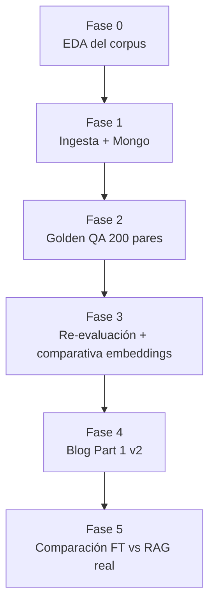

# Plan de Migración de Dataset RAG — Sintético → Real (Stack Exchange)

**Fecha original**: 2026-07-11 (⚠️ **Staleness notice — see below**)
**Autor**: Guillermo (AI Engineer & Full-Stack Developer)
**Contexto**: Portfolio profesión orientado a AI Engineer Senior

> **⚠️ Este documento fue escrito durante la fase de planificación inicial (2026-07-11) y describe el plan de alto nivel. La numeración de milestones, issues y decisiones específicas ha evolucionado significativamente desde entonces. Para la versión autoritativa con cronograma, issues, y dependencias actualizadas, consultar [`plans/MILESTONES.md`](plans/MILESTONES.md) y los archivos bajo `plans/`.**

---

## 1. Motivación

El sistema RAG actual usa **datos sintéticos en español**. El diagnóstico en `blog_part1_rag_diagnostics.md` identificó que los Golden Answers hiperrígidos generados por LLM distorsionan la performance percibida — el LLM juez penaliza desviaciones estilísticas frente a un ideal artificial.

**Migrar a un corpus realy**:
- Elimina el sesgo estructural de los Golden Answers sintéticos.
- Aporta un volumen estadísticamente significativo (~60K vs 745).
- Refleja el estándar profesional internacional (inglés).
- Genera una narrativa de portfolio más sólida: *"diagnosticamos el problema, migramos a datos reales, medimos la mejora"*.

---

## 2. Dataset elegido

**[`flax-sentence-embeddings/stackexchange_titlebody_best_and_down_voted_answer_jsonl`](https://huggingface.co/datasets/flax-sentence-embeddings/stackexchange_titlebody_best_and_down_voted_answer_jsonl)**

- **210,748 pares** totales, 196 MB, inglés, CC-BY-SA 4.0.
- Cada par: `{title_body, upvoted_answer, downvoted_answer}`.
- Pre-filtrado por los autores (gap de 100+ votos entre best/worst).

### Comunidades IT-relevantes seleccionadas (~60K pares)

| Comunidad | Pares | Categoría equivalente (KB actual) |
|---|---:|---|
| `superuser` | 17,425 | Hardware / Oficina inteligente (KB5) |
| `askubuntu` | 9,975 | OO.SS. / general IT |
| `serverfault` | 7,969 | DevOps e Infraestructura (KB3) |
| `apple` | 6,696 | MDM / Movilidad (KB4) |
| `unix` | 6,173 | Infraestructura / sysadmin |
| `android` | 2,830 | MDM / Movilidad (KB4) |
| `security` | 3,069 | Ciberseguridad (KB1) |
| `dba` | 2,502 | Datos / SQL (KB6) |
| `webapps` | 1,906 | Colaboración Cloud (KB2) |
| `sharepoint` | 1,691 | Colaboración Cloud (KB2) |
| `networkengineering` | 476 | Networking |
| `devops` | 53 | DevOps (KB3) |
| **Total** | **~59,800** | |

### Mapeo a la arquitectura actual

| Campo actual (`TicketModel`) | Campo del dataset | Notas |
|---|---|---|
| `ticketId` | generado `SE-{community}-{id}` | Ej: `SE-SUPERUSER-142340` |
| `description` | `title_body` | Consulta original del usuario |
| `priority` | inferible por longitud/comunidad | Banda media por defecto |
| `owner` | `community` | En SE no hay "owner", hay autor |
| `impact` / `actions` | string vacío | No aplica para Q&A |
| `expected_output` (nuevo) | `upvoted_answer` | Ground truth validado por comunidad |
| `community` (nuevo) | split name | Metadata para Pinecone filter |
| `category` (nuevo) | mapping manual | Filtrado por categoría IT (escenarios nuevos) |
| `source` (nuevo) | `"stackexchange"` | Distingue de sintéticos legacy |

### Presupuesto Pinecone Free

- Plan Free: ~100K vectores por índice (embedding ≤1536-dim).
- Embedding `all-minilm:22m` = 384-dim → aplica.
- 2 índices (tickets + KB) → techo ~200K vectores.
- ~60K pares sobra con 140K de headroom para experimentación.
- `expected_output` truncada (500 chars) va en metadata Pinecone; completa se guarda en MongoDB `qa_pairs` (colección nueva, solo para DeepEval).

---

## 3. Decisiones cerradas

| Aspecto | Decisión |
|---|---|
| Dataset | Stack Exchange Q&A, subconjunto IT |
| Idioma | Inglés (UI, prompts, respuestas) |
| Sintéticos actuales | Namespace `kb-synthetic-legacy` — preservados como baseline |
| Pinecone | Mantener 2 índices (Q&A + KBs) — sin refactor retriever |
| Embeddings | Comparar `all-minilm:22m` vs `bge-small-en-v1.5`. Decisión post-Fase 1. |
| Golden QA | 200 pares (50 Exp + 150 Op) |
| agent_app | Sin cambios. Endpoints API mismo schema. |

---

## 4. Fases del plan



### Fase 0 — EDA del corpus

**Objetivo**: Documentar la decisión de filtrado (o no) con evidencia. Narrativa blog.

**Output**: notebook `eda_stackexchange_corpus.ipynb`
- Distribución `len(title_body)` y `len(upvoted_answer)` por comunidad.
- % con código de error (`0x[0-9A-F]+`, `Error \d+`), pasos numerados (regex `\d+\.\s`).
- Mapping comunidad ↔ categoría KB.
- **Output decision**: si filtrar por especificidad técnica o subir las ~60K completas.

**Criterio propuesto para filtrado** (si aplica):
```
score_tech = (regex código error en title_body) 
           + (pasos numerados en upvoted_answer) 
           + (longitud q moderada: 50-1500 chars)
           + (longitud a ≥ 200 chars)
           + (presencia de términos técnicos en q)

Corte: top-N por comunidad con N tal que total ≤ 80K (headroom experimentos).
```

**Hipótesis pre-EDA**: el dataset ya está curado (100-vote gap), el filtro agrega valor marginal. Probablemente el output sea "no filtramos por tamaño, pero documentamos el análisis".

### Fase 1 — Pipeline de ingesta + Mongo

#### Cambios código (todos retrocompatibles)

**`api/models/tickets.py`** — Extend `TicketModel` con campos opcionales:
- `expected_output: str = ""` — para DeepEval
- `community: str = ""` 
- `category: str = "General"`
- `source: str = "stackexchange"`
- Defaults garantizan backward compat con sintéticos.

**`api/modules/rag_tickets_ingestor.py`**:
- `text_splitter`: subir `chunk_size` 200 → 1000, `chunk_overlap` 20 → 100 (title_body hasta 4096 chars).
- Metadata ahora incluye `community`, `category`, `expected_output[:500]`, `source`.
- IDs determinísticos `SE-{community}-{id}_chunk-{i}`.

**`api/modules/rag_unified_retriever.py`** — enriquecer contexto:
```python
for ticket in ticket_results[:TICKETS_TO_CONSIDER]:
    expected = ticket.metadata.get("expected_output", "")
    if expected:
        tickets_to_return.append(
            f"Ticket ID: {ticket.id}\nDescription: {ticket.content[:200]}...\n"
            f"Suggested solution: {expected[:600]}..."
        )
    else:
        # Path legacy (sintéticos) — sin cambios
        tickets_to_return.append(f"Ticket ID: {ticket.id}\n..." 
                                 f"Actions taken: {ticket.metadata.get('actions', '')}\n")
```

**`api/prompts/hyde_ticket.md`** — traducir prompts a inglés. Estructura JSON idéntica.

**`api/modules/rag_kb_ingestor.py`**:
- `KB_CATEGORIES` pasar keys a inglés (`"Cybersecurity & Compliance"`, etc.).
- Keyword regex en `extract_metadata_from_content`: añadir patrones en inglés (`"directed to:"`, `"purpose:"`).
- Lógica de mapeo comunidad → categoría IT nuevo.

**`api/modules/database.py`** — nueva colección `qa_pairs`:
```python
await db.db.qa_pairs.create_index("ticketId", unique=True)
await db.db.qa_pairs.create_index("category")
await db.db.qa_pairs.create_index("community")
```
Solo se consulta para DeepEval runtime (no impacta retrieval).

#### Script nuevo: `api/scripts/ingest_stackexchange_dataset.py`

Pipeline consolidado:
1. `datasets.load_dataset("flax-sentence-embeddings/stackexchange_titlebody_best_and_down_voted_answer_jsonl", split=<comunidad>)` para las 12 comunidades.
2. Post-procesa a schema `TicketModel` extendido (`SE-{community}-{id}`, reglas de `priority` por heurística).
3. Ingesta a Pinecone (namespace `kb-se-{community}` o uno solo con metadata filter).
4. Inserta en Mongo `qa_pairs` (`upvoted_answer` completa).
5. Regenera `api/static/bm25_index.json` con `page_content = title_body + " " + answer[:500]`.

**BM25 index**: hoy 408K, 4210 líneas. Con nuevo dataset estimo ~10-15 MB. Formato igual.

> ⚠️ **Hallazgo (2026-08-01) — estimación superada 8-12x**: el índice real del corpus Stack Exchange resultó de **125 MB** (28 MB en gzip -9). Este tamaño lo hace **imposible de desplegar en producción**: (1) GitHub rechaza archivos >100 MB, bloqueando el push; (2) Vercel serverless no puede cargarlo en runtime — el `json.load` + construcción del `BM25Retriever` (~60K documentos) excede el timeout de 10 s y la RAM de 1 GB del plan Hobby. Consecuencia: **el híbrido BM25+Vector solo funciona en local/desarrollo**. La solución natural es migrar la búsqueda híbrida a MongoDB Atlas Search (`$search` + `$vectorSearch` + `$rankFusion`), aprovechando que los datos ya viven en `qa_pairs` (ver M7).

#### Comando surfacing
```bash
cd api
python scripts/ingest_stackexchange_dataset.py \
  --communities superuser,askubuntu,serverfault,apple,unix,android,security,dba,webapps,sharepoint,networkengineering,devops \
  --namespace-prefix se \
  --embedding-model all-minilm:22m \
  --dry-run  # primera pasada para validar formatos
```

### Fase 2 — Nuevos golden QA datasets (200 pares)

**Output**: reemplazo de `evaluation_notebooks/goldens/golden_expert.json` y `golden_operational.json`.

Sampleo estratificado desde `qa_pairs` Mongo:
- **Experto (50)**: comunidades `dba`, `networkengineering`, `serverfault`, `devops`, `security`. 10 por comunidad.
- **Operativo (150)**: comunidades `superuser` (50), `askubuntu` (50), `apple`/`android` (25), `sharepoint`/`webapps` (25). Distribución mayor para reflejar volumen de L1.

Estructura DeepEval-compatible (sin cambios vs esquema actual):
```json
{
  "question": "<title_body>",
  "answer": "<upvoted_answer>",
  "category": "Expert|Operational",
  "ticketId": "SE-SUPERUSER-142340",
  "kb": "SE-SUPERUSER-142340"
}
```

Script nuevo: `api/scripts/build_golden_qa.py` — seed fija para reproducibilidad.

### Fase 3 — Re-evaluación + comparativa embeddings

#### Notebook `local_evaluation_pipeline/rag_experiments_evaluator.ipynb`

- `GOLDEN_DATASETS` apuntando a los nuevos archivos.
- Cache incremental limpio (o namespace distinto) → re-captura full.
- **Escenarios extendidos** (de 4 a 6+):

| # | Escenario | Namespace | Metadata filter | Objetivo |
|---|---|---|---|---|
| 1 | Baseline Vector Only | `kb-se-all` | — | Reproduce el problema cross-domain |
| 2 | Hybrid, no RRF | `kb-se-all` | — | Tu setup actual 1:1 |
| 3 | Hybrid + RRF + Semantic Chunking | `kb-se-semantic` | — | Tu setup actual |
| 4 | Hybrid + RRF + Markdown Headers | `kb-se-markdown` | — | Tu setup actual |
| 5 | **Hybrid + RRF + Metadata `category`** | `kb-se-all` | `{"category": {"$eq": ...}}` | **NUEVO** — tu propuesta del blog |
| 6 | **Hybrid + RRF + Metadata `community`** | `kb-se-all` | `{"community": {"$eq": ...}}` | **NUEVO** — filtrado fino |

- DeepEval metrics actuales: `ContextualPrecision`, `ContextualRecall`, `Faithfulness`, `AnswerRelevancy`, `Correctness` (GEval custom si ya lo tenés).
- Cache `local_benchmarking_results.json` backup antes de resetear.

#### Comparativa embeddings (decisión post-Fase 1)

Después de la ingesta Fase 1 con `all-minilm:22m`:
- Correr el notebook Fase 3 y registrar `ContextualPrecall` global.
- Si `< 30%`: re-ingestar con `BAAI/bge-small-en-v1.5` en namespace `kb-se-bge` (mismo índice, namespace distinto, mismo 384-dim).
- Comparar los dos escenarios lado a lado — decido embedding definitivo.

Story portfolio: *"evalué dos modelos de embeddings sobre el mismo corpus real y seleccioné uno basado en métricas"*.

### Fase 4 — Blog Part 1 v2

Reescribir `blog_part1_rag_diagnostics.md`:
1. **Numerar la sección actual**: presentar el MVP sintético con 22% Correctness como **baseline histórico** (preserva lo ya escrito).
2. **Nueva sub-sección "El problema de los datos sintéticos"**: diagnoser el sesgo.
3. **Nueva sub-sección "Migración a corpus real"**: narrativa EDA + argumento del corte.
4. **Nueva sub-sección "Re-evaluación con datos reales"**: comparativa lado a lado — impacto en Correctness, Faithfulness, etc.
5. **Nueva sub-sección "Mejora con Metadata Filtering"**: delta cuantitativo de tu propuesta hecha medida.

### Fase 5 — Comparación FT vs RAG con datos reales (opcional)

`blog_part2_rag_vs_finetuning.md` se refuerza:
- Fine-tuning Qwen 2.5 sobre el mismo corpus (submuestra para bajar costo de cómputo del Colab).
- DeepEval con mismo judge sobre los 200 pares golden nuevos.
- Apples-to-apples: ahora sí ambos compiten contra **ground truth humano**, no sintético.

Punto de venta Senior AI Engineer: *"migré el dataset a realidad, reconstruí la evaluación y revalidé mi tesis comparativa"*.

---

## 5. Análisis de riesgos y mitigaciones

| Riesgo | Probabilidad | Impacto | Mitigación |
|---|---|---|---|
| Embeddings `all-minilm:22m` performan pobre sobre corpus inglés técnico 60K | Media | Retrieval bad → metrics bajas | Plan de comparativa Fase 3 (bge-small-en-v1.5 de backup) |
| Pinecone Free UPDATE por exceder vectors | Baja | Bloqueo ingesta | Solo 60K, margen enorme. Validar counts en Fase 1 con `--dry-run`. |
| Respuestas largas con código rompen prompt context | Media | LLM alucina | `text_splitter` 1000-chunk + `expected_output[:600]` en contexto |
| MongoDB `qa_pairs` crece demasiado | Baja | Costo del tier | Solo 60K docs ligeros. ~50MB total, dentro de Free. |
| BM25 regenerado pesado para Vercel serverless cold start | Media | Latencia primer request | Cargar perezoso, solo si se usa. Evaluar mover a S3 + cache. |
| Cambios en `TicketModel` rompen tests existentes | Baja | CI red | Defaults en todos los campos nuevos → tests legacy sin cambios. |
| `extract_kb_category` confunde categoría ahora que las keywords son inglés | Media | Bad metadata filter | En Fase 1 actualizar regex inglés + test. |
| Ingesta SE de 60K pares consume cuota Ollama local | Media | Lento / rate-limit | Batch de 100 en 100, backoff exponencial, idempotente por ID. |

---

## 6. Orden de ejecución sugerido

1. ✅ Fase 0: EDA (`eda_stackexchange_corpus.ipynb`) — sin tocar productivo.
2. ✅ Fase 1: Cambios en código productivo + script ingesta. `--dry-run` primero.
3. ✅ Fase 2: Build golden QA (`build_golden_qa.py`).
4. ✅ Fase 3: Re-eval + comparativa embeddings (async, corre solo).
5. ✅ Fase 4: Blog v2 (post-resultados).
6. ⏸️ Fase 5: Opcional, después de reflejar sobre resultados Fase 3.

---

## 7. Apéndice:Heatmap de mapeo Stack Exchange → Tareas

| Tarea IT típica L1 | Comunidad SE principal | Comunidad secundaria |
|---|---|---|
| Reset MFA / 2FA | `security` | `superuser` |
| VPN no conecta | `serverfault` | `networkengineering` |
| Outlook no envía / error 0x... | `superuser` | `webapps` |
| SharePoint permisos | `sharepoint` | `webapps` |
| Docker no levanta | `serverfault` | `devops` |
| MDM enrolamiento Apple | `apple` | — |
| MDM enrolamiento Android | `android` | — |
| SQL Server lock chain | `dba` | `serverfault` |
| Linux script/systemd | `unix` | `askubuntu` |
| Ubuntu no bootea | `askubuntu` | `superuser` |
| Wi-Fi Rogue AP | `security` | `networkengineering` |
| FileVault/BitLocker | `security` | `apple` |

Cobertura L1: ✓ confirmada para tus 6 categorías KB actuales + 1 nueva (Networking).

---

## 8. Pendientes abiertos

Ninguno. Plan aprobado por usuario en sesión 2026-07-11. Próximo paso: ejecución Fase 0 cuando el usuario lo indique.

---

## Appendix A: Stash register — Architectural improvements set aside

**Date**: 2026-07-12
**Branch**: `wip/architectural-improvements-stash`
**Base commit**: `d906c9f` (main, merged PR #41)

The following uncommitted changes from the previous development cycle (`refactor/move-from-langchain-agent-to-custom-agent-with-langgraph` branch) were stashed into a dedicated branch to keep the data migration baseline clean:

### Changes stashed

| File | Change type | Description |
|------|-------------|-------------|
| `api/app.py` | Enhancement | Passes `namespace` to `augment_search_results` and `raw_unified_search` endpoints |
| `api/models/search.py` | Enhancement | Adds `namespace: str` field to `SearchRequest` and `RawSearchRequest` |
| `api/modules/rag_unified_retriever.py` | **Major** | Implements Reciprocal Rank Fusion (RRF) replacing simple priority merge; `search_kb_documents` now accepts `namespace` and `metadata_filter` |
| `api/modules/rag_kb_ingestor.py` | **Major** | Supports 3 chunking strategies (baseline, markdown, semantic) + `namespace` parameter; new helper `get_kb_vector_store()` |
| `api/modules/third_party_clients.py` | Enhancement | Adds `get_kb_vector_store(namespace)` factory function |
| `api/run_kb_ingestion.py` | Enhancement | CLI with chunk_strategy and namespace selection |
| `api/modules/security.py` | Config | IP quota and user quota limits commented out (dev mode) |
| `.gitignore` | Config | Added ignores for `.deepeval`, `plans/*`, `evaluation_notebooks`, etc. |

### Next initiative (planned)

These stashed changes will become the kickoff of the **next** improvement initiative (`initiative:architectural-improvements`), which runs after the data migration (M3) is published. The narrative for the blog will be:

> *Phase 1: migrated data only — baseline measured on synthetic vs real corpus.*
> *Phase 2: added RRF, chunking strategies, namespaces, metadata filters — delta measured on top of real corpus baseline.*
