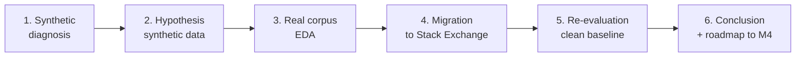

# Write blog: "Diagnosing and fixing the synthetic-data bias in a RAG evaluation pipeline"

## Meta

- **Milestone**: M3 — Publication
- **Labels**: `initiative:rag-real-data-migration`, `phase:docs`, `type:content`, `priority:high`, `area:blog`
- **Estimate**: 1 day
- **Depends on**: Issue #10 (re-eval with real data — pure data-migration delta)

## Description

As a Technical Writer, I want to rewrite `blog_part1_rag_diagnostics.md` under the angle **"Diagnosing and fixing the synthetic-data bias in a RAG evaluation pipeline"** — highlighting the methodological contribution (identifying a specific measurement bias and designing a controlled ablation to measure its impact) rather than the generic "I built a RAG with real data" framing. The blog turns what was a "problem diagnosis" into a "measurable data-migration improvement story" that isolates the effect of swapping synthetic data for real data, with architecture held constant. Architectural improvements (RRF, chunking strategies, metadata filtering, embedding swap) are intentionally deferred to a future M4 narrative ("Phase 2: Architectural Improvements").

### Narrative Context

The current blog Part 1 ends with:
> "The system is already built, orchestrated, and running end-to-end. The low initial numbers are not a failure, but a measurable baseline."

The new narrative arc **preserves** that section as a historical diagnosis and **continues** with the data-migration story:



### Scope — What This Issue Writes Into The Blog

Only the **data-migration narrative arc**. Architectural improvements are explicitly excluded and mentioned as "Phase 2 (incoming)" roadmap, NOT as part of this Phase 1 story.

### Scope — What This Issue DEFERS To The M4 Blog Post

| Excluded section (was in original plan) | Reason | Where it goes now |
|---|---|---|
| Section 8 "The Architectural Improvement: Metadata Filtering" | Requires stashed features (namespace + metadata_filter on RawSearchRequest) that are NOT on `main` | Becomes central section of the M4 blog post ("Phase 2: Architectural Improvements") |
| Section 9 "Embedding Evaluation: A Data-Driven Decision" | Issue #11 itself deferred to M4 | Idem M4 blog post |

### New Version Structure (8 sections)

The blog reorganizes into these sections:

1. **(Existing, preserve)** Context and Base Architecture.
2. **(Existing, preserve)** Opening the Black Box: Evaluation Metrics.
3. **(Existing, preserve)** Diagnosing a Bottleneck: The Retriever.
4. **(Existing, preserve)** The Synthetic Data Trap.
5. **(NEW)** The Hypothesis: If the problem is the data, let's change it.
6. **(NEW, from Issue #2 draft)** Migration to Real Corpus: Stack Exchange EDA.
7. **(NEW)** Results with Real Data: Side-by-Side Re-evaluation (clean baseline).
8. **(NEW)** Conclusion: From Diagnosis to Data-Migration Delta — and What's Next (roadmap to M4 architectural improvements).

### Acceptance Criteria

- [ ] `blog_part1_rag_diagnostics.md` rewritten with the new 8-section structure.
- [ ] Sections 1-4 preserved with minimal edits (fix typos, do not change conclusions).
- [ ] Section 5 introduces the hypothesis: "What if the problem isn't in the LLM or the retriever, but in the data?".
- [ ] Section 6 uses the draft from Issue #2 + update with real EDA results.
- [ ] Section 7 shows comparative table: synthetic vs real metrics (from Issue #10 results — 4 scenarios, NO metadata filter scenarios).
- [ ] Section 8 closes with:
  - The data-migration delta narrative: "from 22% Correctness to X%, not by changing the LLM but by changing the data — with architecture held constant".
  - Forward-looking note: architectural improvements (RRF, chunking strategies, namespaces, metadata filters, embedding comparison) are stashed and ready, to be evaluated and measured on top of this new real-corpus baseline in a future Phase 2 post.
- [ ] Include placeholders for figures generated in the notebook: `*([Placeholder: ...])*`.
- [ ] Tone: first person, honest, without overstating (if numbers don't improve as much as expected, document it — that's seniority).
- [ ] Links to the specific notebooks that generated each result.
- [ ] Commit with message `docs(blog): rewrite Part 1 as "Diagnosing and fixing the synthetic-data bias"`.

### Section 7 — Expected Comparative Table (Placeholder, 4 scenarios only)

```markdown
| Metric | Synthetic (legacy) | Real (SE) | Δ |
|--------|-------------------:|----------:|--:|
| Correctness | 22% | ?% | +? pts |
| Faithfulness | 84% | ?% | ? pts |
| Contextual Precision | 10% | ?% | +? pts |
| Contextual Recall | 10% | ?% | +? pts |
| Answer Relevancy | 56% | ?% | ? pts |
```

The `?` are filled with actual results from Issue #10. **Do not fabricate numbers** — if a metric drops, document it honestly.

### References

- Blog to rewrite: [`blog_part1_rag_diagnostics.md`](../../blog_part1_rag_diagnostics.md)
- Initial draft (Issue #2): `blog_part1_draft_migration_section.md`
- Evaluation notebook: [`local_evaluation_pipeline/rag_experiments_evaluator.ipynb`](../../local_evaluation_pipeline/rag_experiments_evaluator.ipynb)
- Stashed architectural improvements: `RAG_DATASET_MIGRATION_PLAN.md` Appendix A
- Base plan: [`RAG_DATASET_MIGRATION_PLAN.md`](../../RAG_DATASET_MIGRATION_PLAN.md)

### Notes

- **Do NOT add sections 8 (metadata filtering) and 9 (embedding comparison)** from the original plan — those belong to M4.
- **Do NOT delete the original blog** until the new one is approved. If you want to keep the original, rename it to `blog_part1_rag_diagnostics_legacy.md` and reference it as "initial version" in the new one.
- The blog is bilingual (`.es.md` and `.en.mdx` in the portfolio). This Issue only covers the file in `Tarea_2/`. The English translation for the portfolio is done in Issue #13.
- This Phase 1 narrative deliberately ends with an open hook to M4 (Phase 2), creating anticipation for the architectural-improvements post. This two-phase structure is portfolio-grade engineering communication: "we measured one thing at a time".
- The narrative "diagnosed, hypothesized, migrated, measured, isolating the data variable" is exactly what a senior hiring committee wants to read — it's evidence of structured engineering thinking and ablation discipline.
