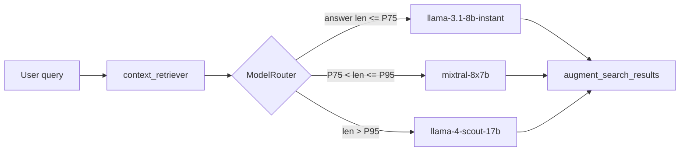

# Implement hybrid model router based on answer length — DEFERRED to M9

## Meta

- **Milestone**: M6 — Cost-Optimized Hybrid Inference (router deferred)
- **Deferred to**: M9 — Architectural Improvements
- **Labels**: `initiative:cost-optimized-inference`, `phase:implementation`, `type:feature`, `priority:medium`, `area:backend`
- **Status**: ⏸️ Deferred. M6 is now benchmark-only. The current generator model (deepseek flash 0731, Jul 31) is near-optimal in cost/quality. The router is only implemented if the M6 benchmark shows another model significantly outperforming the current one. In that case, it goes to M9.

## Description

As an AI Engineer, I want to implement a `ModelRouter` module that inspects the context returned by `context_retriever_for_unified_search` and selects the LLM based on the average length of the retrieved `expected_output` values, so that 75% of queries are served by a small, cheap model and only 25% require the expensive model — saving ~68% on inference costs.

### Architecture



### Module: `api/modules/model_router.py`

```python
"""Cost-aware model router that selects LLM based on retrieved answer complexity."""

import os
from typing import Optional

# Thresholds discovered during EDA log-normal analysis (P75, P95)
# These can be overridden via environment variables for A/B testing
DEFAULT_P75_THRESHOLD = int(os.getenv("ROUTER_P75_THRESHOLD", "887"))
DEFAULT_P95_THRESHOLD = int(os.getenv("ROUTER_P95_THRESHOLD", "2306"))

# Models for each bucket (overridable via env vars for A/B testing)
CHEAP_MODEL = os.getenv("ROUTER_CHEAP_MODEL", "llama-3.1-8b-instant")
MEDIUM_MODEL = os.getenv("ROUTER_MEDIUM_MODEL", "mixtral-8x7b-32768")
EXPENSIVE_MODEL = os.getenv("ROUTER_EXPENSIVE_MODEL", "llama-4-scout-17b-16e-instruct")


def estimate_complexity(retrieved_context: list[str]) -> float:
    """
    Estimates the complexity of the retrieved context by averaging the length
    of the expected_output (or the description, as fallback).
    
    Returns the average character length of the context items.
    """
    if not retrieved_context:
        return 0.0
    
    lengths = [len(c) for c in retrieved_context]
    return sum(lengths) / len(lengths)


def select_model(avg_length: float, 
                 p75: int = DEFAULT_P75_THRESHOLD,
                 p95: int = DEFAULT_P95_THRESHOLD) -> str:
    """
    Selects the appropriate model based on the average context length.
    
    Args:
        avg_length: Average character length of retrieved expected_output items.
        p75: P75 threshold (characters) — answers below this go to cheap model.
        p95: P95 threshold (characters) — answers above this go to expensive model.
        
    Returns:
        str: Model name string.
    """
    if avg_length <= p75:
        return CHEAP_MODEL
    elif avg_length <= p95:
        return MEDIUM_MODEL
    else:
        return EXPENSIVE_MODEL
```

### Changes to `api/app.py`

The endpoint `augment_search_results_endpoint` currently uses `search_req.model_name` to select the LLM. When the feature flag `hybrid_inference` is enabled, the endpoint should:

1. Call `context_retriever_for_unified_search` first (always happens anyway).
2. If `hybrid_inference` enabled, pass the retrieved context to `model_router.select_model()`.
3. Use the returned model name for the LLM call.
4. If `hybrid_inference` disabled, use the user-provided `model_name` (current behavior — backwards compatible).

### Feature flag

Add feature flag `hybrid_inference` to the existing feature flags system (MongoDB `feature_flags` collection + `is_feature_enabled` function):

```python
# In main.py or app.py, during endpoint logic:
if await is_feature_enabled("hybrid_inference"):
    avg_len = estimate_complexity(retrieved_context)
    selected_model = select_model(avg_len)
else:
    selected_model = search_req.model_name
```

### Acceptance Criteria

- [ ] `api/modules/model_router.py` created with `estimate_complexity()` and `select_model()`.
- [ ] Both functions have dedicated unit tests in `api/tests/test_model_router.py`.
- [ ] Feature flag `hybrid_inference` added to MongoDB `feature_flags` collection (disabled by default — opt-in).
- [ ] `augment_search_results_endpoint` in `api/app.py` updated to call `model_router` when the feature flag is enabled.
- [ ] When `hybrid_inference` is disabled, the endpoint behaves exactly as before (backwards compatible).
- [ ] Thresholds configurable via environment variables `ROUTER_P75_THRESHOLD`, `ROUTER_P95_THRESHOLD` — for A/B testing.
- [ ] Admin dashboard (`admin`) shows current router configuration (thresholds + active model selections).
- [ ] Logging: each request with `hybrid_inference` enabled logs `[HYBRID] bucket=short model=llama-3.1-8b avg_len=467` (useful for monitoring).
- [ ] Cost tracking: `model_router.log_cost()` stores per-request model choice and estimated cost in a local CSV for cost-attribution analysis.
- [ ] Commit with message `feat(api): add cost-aware hybrid model router`.

### Test plan

1. **Unit tests**: mock `context_retriever` output at various lengths (50, 500, 1500, 3000 chars). Verify `select_model` returns correct model.
2. **Integration test**: enable `hybrid_inference` flag, run a query that would trigger the cheap model, verify the response is from `llama-3.1-8b-instant`.
3. **Integration test**: same query with flag disabled, verify the response uses the default model from the user's request.
4. **Edge case**: empty context → `estimate_complexity` returns 0.0 → uses cheap model (best-effort).
5. **Edge case**: mixed-length context returns lengths that average to P75 boundary → verify boundary behavior (≤ vs <).

### Cost tracking format (stored in `api/static/hybrid_cost_log.csv`)

```
timestamp,ticketId,model,avg_len,estimated_cost
2026-08-01T10:00:00Z,SE-SUPERUSER-142340,llama-3.1-8b-instant,467,0.000058
2026-08-01T10:00:01Z,SE-DBA-2502,llama-4-scout-17b,1892,0.000472
```

### References

- Benchmark results (Issue #20): `plans/M6_HybridInference/20_Benchmark_LLMs_by_complexity.md`
- EDA bonus cell (log-normal discovery): `evaluation_notebooks/eda/eda_stackexchange_corpus.ipynb`
- Base plan: [`RAG_DATASET_MIGRATION_PLAN.md`](../../RAG_DATASET_MIGRATION_PLAN.md)
- Existing feature flags: `api/modules/database.py` (`is_feature_enabled`)

### Notes

- This feature is **opt-in via feature flag** so it can be safely deployed without affecting existing users.
- The cost log CSV is intentionally simple — no need for a full billing system at this stage. It serves as an audit trail to validate the expected savings against real traffic.
- If Issue #14 shows that the "Medium" and "Long" buckets can use the same model (e.g., `mixtral` covers both), the router simplifies to a two-branch binary instead of three — adjust thresholds and models accordingly.
