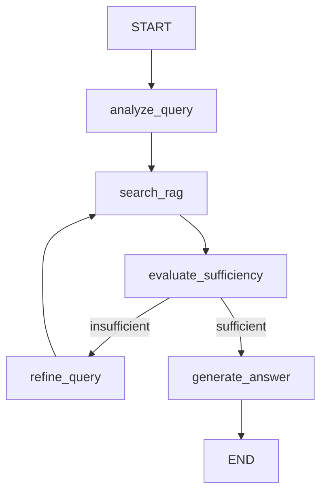

# M7 — Multi-Step Diagnosis Agent: Overview

## Meta

- **Milestone**: M7 — Multi-Step Diagnosis Agent
- **Initiative**: `initiative:agentic-diagnosis`
- **Depends on**: M4 (working retrieval with voyage-4-lite + MongoDB lexical search)
- **Feeds**: Portfolio close — the agent consumes the optimized RAG and demonstrates multi-step reasoning

## Problem Statement

The current agent (`agent_app/`) is a basic ReAct loop: user asks → LLM decides to search or not → responds. It makes a single retrieval pass. If the first search returns vague or insufficient context, the agent has no mechanism to detect the gap, reformulate the query, and try again. This is essentially a thin wrapper around the RAG API — it doesn't demonstrate reasoning beyond the RAG itself.

M7 transforms this into a **multi-step diagnosis agent** that iterates on retrieval until it has sufficient information to answer, then synthesizes a response from accumulated context. **A key motivator comes from M4's hybrid search finding**: semantic-only search is optimal on average (ContextualPrecision 69.40%), but queries with error codes, command names, or specific IDs benefit from lexical search. The agent decides per-query whether to activate the lexical component — turning a negative M4 finding into an agent capability.

## Agent Architecture



### Nodes

| Node | Role | LLM call? |
|------|------|:---:|
| `analyze_query` | Classify the query (OS/hardware/security/ambiguous), extract key entities, **determine search strategy: vector_only default, hybrid (add lexical) when lexical-heavy signals detected** (error codes, command names, IDs, version strings) | Yes |
| `search_rag` | Call `POST /api/raw_unified_search` with current (possibly refined) query and the strategy decided by analyze. Accumulate context. | No (API call) |
| `evaluate_sufficiency` | Judge: is accumulated context enough to answer? Check for contradictions, gaps, or irrelevance. | Yes |
| `refine_query` | Reformulate: add specificity, domain terms, alternative phrasings. Based on what's missing. | Yes |
| `generate_answer` | Synthesize final answer from all accumulated context. Cite sources. | Yes |

### Search strategy routing (motivated by M4 findings)

M4 demonstrated that hybrid (vector + lexical) **does not help on average** — it even hurts ContextualRecall (−2.72 pts) — but lexical matching is valuable for queries with heavy lexical load (error codes, command names, IDs). The agent's `analyze_query` node decides per-query:

- **Default**: `vector_only` (the M4 winner)
- **Lexical-heavy signals detected** (regex: `0x[0-9a-f]+`, command names, version patterns): `hybrid` — lets BM25/Atlas Search contribute exact-token matches

This implements the promise made in the M4 blog: dynamic routing between semantic and lexical search based on query characteristics.

### State

```python
class DiagnosisState(TypedDict):
    messages: list  # LangGraph messages
    accumulated_context: list[str]  # all retrieval results across iterations
    iteration_count: int
    query_history: list[str]  # original + refined queries
    sufficient: bool  # evaluate_sufficiency flag
    max_iterations: int  # hard stop at 3
    search_strategy: str  # "vector_only" | "hybrid" — decided by analyze_query
```

### Key design decisions

1. **Max 3 iterations** — prevents infinite loops. After 3 rounds, generate answer with whatever context exists.
2. **Context accumulation** — each search adds to `accumulated_context`, never replaces. The generator sees everything.
3. **Source citation** — every retrieved document has a `ticketId`; the generator must cite which sources support each claim.
4. **Feature flags** — respects `enable_rag_tool` from the API. Can be toggled for A/B testing.
5. **Backward compat** — the existing ReAct agent remains available via feature flag until M7 agent is validated.
6. **LLM provider migration (prerequisite)** — `agent_app` currently uses `ChatGroq` (`backend/core/config.py`). Must migrate to `ChatOpenAI` + OpenRouter (same migration `api/` did in M2) so the agent uses the same models as the RAG.
7. **Model per node configurable** — `AGENT_MODEL` env var controls the model for all nodes. **Conditional on M6**: if M6 finds a cheaper model (e.g., ling-2.6-flash) with comparable quality, the agent can use it for low-risk nodes (analyze, evaluate, refine) and reserve the best model for generate — a config change, not an architecture change. Not implemented unless M6 justifies it.

## Evaluation strategy

Compare M7 agent vs base RAG (M4) on the same 50 golden QA pairs:

| Métrica | Base RAG (M4) | M7 Agent | Expectativa |
|---------|:---:|:---:|:---:|
| Correctness | M4 baseline | ? | ≥ M4 |
| Faithfulness | M4 baseline | ? | ≥ M4 (citation enforcement) |
| AnswerRelevancy | M4 baseline | ? | ≥ M4 |
| Avg iterations | 1 | ? | 1-3 |
| Avg latency | ~3s | ? | ≤ 10s |

## Design input from M4 (2026-08-04): dynamic search-strategy routing

M4 found that with `voyage-4-lite`, **hybrid search no longer helps on average**: vs vector_only (gpt-5.6-luna judge), hybrid added +0.25 CP but **lost −2.72 CR** (Correctness −1.20, Faithfulness −0.33). The dense model already captures the corpus well; a naive 50/50 lexical merge dilutes it. However, hybrid is still expected to help for **lexical-heavy queries** (error codes, command names, IDs) — which is exactly the class of query an L1 support agent receives.

**Implication for the agent**: instead of a fixed search method, `analyze_query` should **route** between `vector_only` (default) and `hybrid` (when the query contains error codes / exact identifiers / jargon). This makes the M7 agent's retrieval adaptive — the thing a single-pass hybrid merge cannot do. The `search_rag` node should accept `search_method` as part of the agent state.

**Baseline note**: the evaluation table above should compare against **both** M4 configs (vector_only 51.00/98.38/95.86/69.40/25.91 and hybrid 49.80/98.05/95.94/69.65/23.19, gpt-5.6-luna), since the agent's routing may beat either fixed strategy.

## What is OUT of scope

- MCP server (deferred to M9 — architectural refinements)
- Tool expansion beyond RAG search + web search
- Agent evaluation via DeepEval on agent-specific metrics (task completion, user satisfaction) — DeepEval's agent metrics are experimental
- Multi-agent orchestration

## Definition of Done

- [ ] New LangGraph graph with analyze → search → evaluate → refine → generate nodes
- [ ] `accumulated_context` state with deduplication across iterations
- [ ] Hard stop at 3 iterations
- [ ] Source citation in generated answers
- [ ] Evaluated against 50 golden QA pairs with same M4 judge
- [ ] Comparative table: M4 baseline vs M7 agent
- [ ] Existing ReAct agent preserved behind feature flag
- [ ] Blog entry: "From RAG to Agent: Multi-Step Diagnosis that Reasons Before It Answers"
