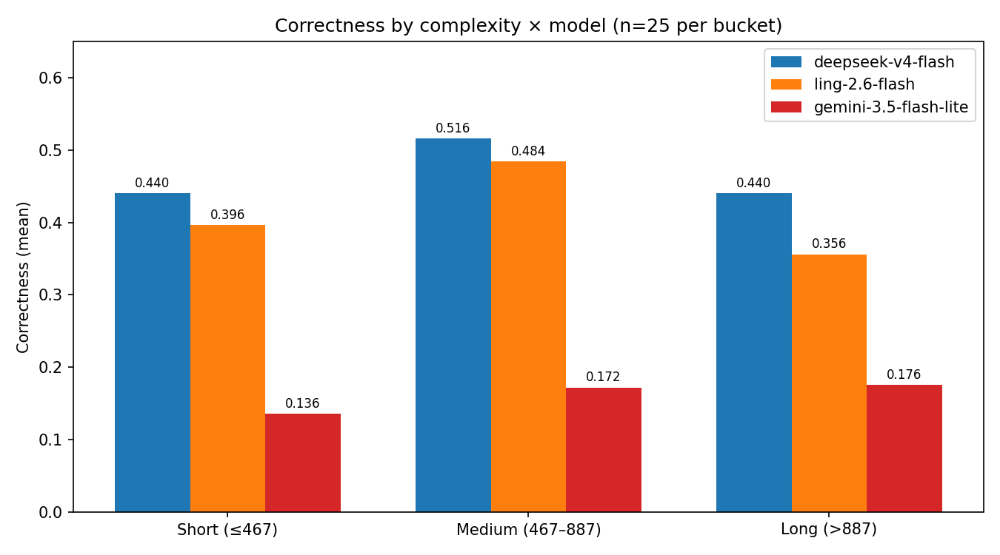
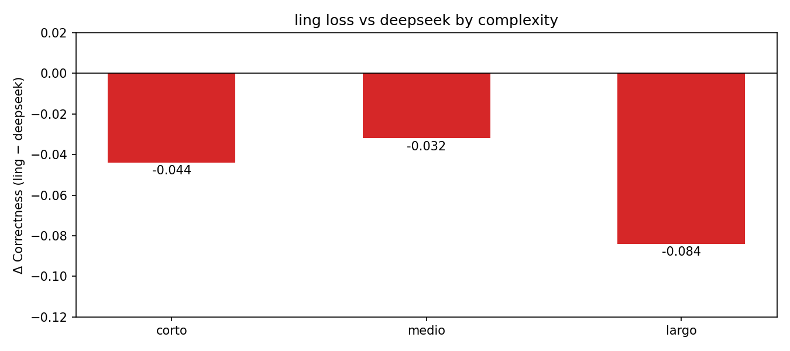
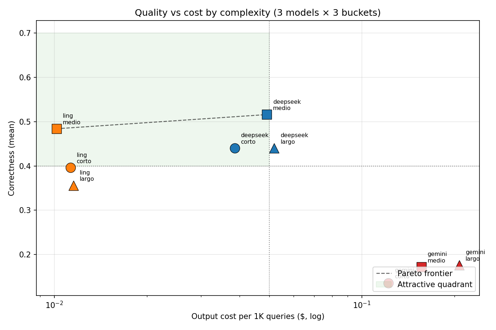
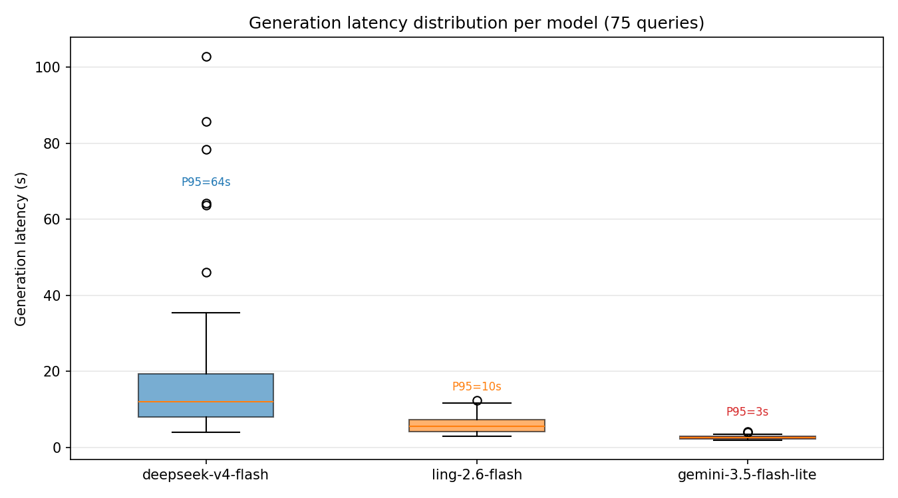
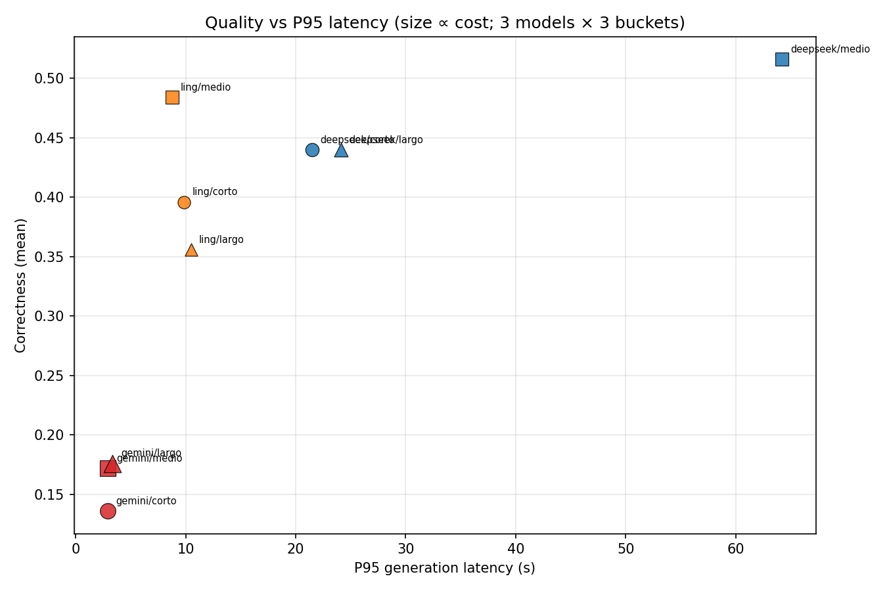
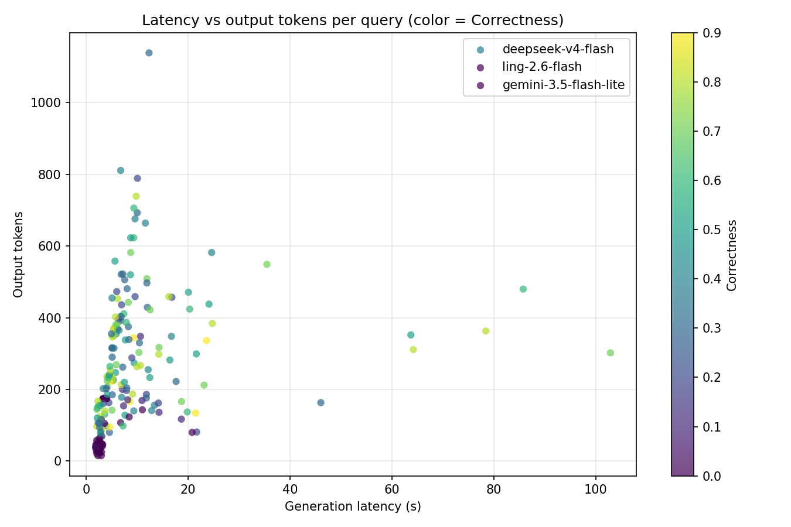

# ¿Cuánto cuesta responder bien? Cuando el costo de inferencia se decide con datos

---

En la entrada anterior de esta serie se cerró la optimización del *retrieval* con la confirmación de que reemplazar al modelo de embeddings, la precisión contextual pasó de 60.33% a 69.40%, lo cual representa aproximadamente 9 puntos de crecimiento usando el mismo juez. Con la búsqueda semántica arrojando resultados de buena calidad, la siguiente pregunta natural resulta ser: **¿estamos usando el modelo generador correcto? ¿Cuánto cuesta responder bien?**

A partir de un benchmark de tres modelos generadores sobre el mismo *retrieval* optimizado, con calidad, costo **y latencia** medidos por query se pretende analizar las distintas ventajas y desventajas de cada uno de los LLMs usados para generar la respuesta, de forma tal de poner en discusión si DeepSeek V4 Flash (0423) es el mejor modelo para los distintos casos. 

El veredicto confirma al modelo en producción con datos — aunque con un matiz estadístico importante que desarrollaremos: la ventaja global del ganador está al borde del ruido del juez, y solo en las respuestas largas es claramente significativa. El análisis también descarta a un candidato caro, identifica al perdedor "honorable" que domina la frontera costo-calidad, y revela un hallazgo sobre la distribución log-normal del corpus que reformula la intuición original sobre cuándo un modelo barato alcanza.

## El hallazgo del EDA: la distribución log-normal de las respuestas

Durante el análisis exploratorio del corpus de Stack Exchange, se detectó algo colateral que en su momento merecía una nota marginal y ahora es el fundamento de esta entrada: **la longitud de las respuestas sigue aproximadamente una distribución log-normal**.

| Percentil | Longitud de respuesta (chars) |
|---|---:|
| P25 | 244 |
| P50 (mediana) | 467 |
| P75 | 887 |
| P95 | ~2,306 |
| Máximo | 30,141 |

TODO: Reemplazar tabla con algún gráfico robado del EDA.

El ajuste se validó con el test de Kolmogorov-Smirnov sobre el corpus ($p = 0.0414$, el valor exacto del notebook del EDA). La lectura honesta es la opuesta a la intuición del "casi": al 95% de confianza ($\alpha = 0.05$) el test **rechaza** el ajuste, y también lo rechaza al 90% ($\alpha = 0.10$); solo deja de rechazarlo al 99% ($\alpha = 0.01$). O sea, usar un nivel de significación menos exigente no rescata la log-normal: la hunde. Queda entonces como una *aproximación de trabajo*, no como un modelo validado — captura el cuerpo central de la distribución, pero su cola derecha real es más pesada de lo que predice. Los percentiles que usamos en esta entrada (P50 467, P75 887) son empíricos, calculados directamente sobre los datos y no derivados del modelo ajustado, así que siguen siendo umbrales válidos para estratificar.

**¿Por qué importa?** Una distribución log-normal con cola larga a la derecha significa que la gran mayoría de las respuestas son cortas (el 75% está por debajo de 887 caracteres) y solo una minoría exige respuestas largas y complejas. La intuición original era: si las consultas del sistema producen respuestas cortas la mayoría de las veces, un modelo pequeño y barato podría responderlas sin pérdida de calidad, reservando los modelos grandes y caros para el 25% de consultas restantes. 

La estimación inicial del EDA prometía un ahorro del orden del **68%** del costo por 1,000 consultas (ver su [correspondiente informe](../1_dataset_migration_EDA/dataset_migration_EDA_es.md)). Conviene revisar de dónde salía ese número y qué le pasa al recalcularlo con la información que hoy tenemos.

El cálculo del EDA era un orden de magnitud hecho antes de la migración, con tres supuestos que ya no aplican: (a) el mix log-normal (75% de respuestas cortas, 25% largas); (b) un modelo barato a ~$0.05/M y uno caro a ~$0.20/M; y (c) un proxy de tokens de 4 caracteres por token. Sobre esa base, enrutar el 75% corto al modelo barato y reservar el caro para el 25% largo daba un ahorro relativo de ~68%.

Al recalcular ese mismo mix con los precios reales del benchmark y los tokens medidos con `tiktoken` (no el proxy), el porcentaje de ahorro **se mantiene**: enrutar las cortas a ling ahorra ~54% contando solo la salida ($0.0215/1K contra $0.0466/1K de siempre-DeepSeek), y ~64% si además se incluye el input compartido, que ling factura a un noveno del precio. La promesa relativa del EDA era correcta.

Lo que el EDA no podía prever es que esas consultas **ya cuestan centavos**: los $0.025/1K de ahorro en salida (o $0.15/1K con input) se vuelven irrelevantes frente al costo de un router. Y hay un supuesto de calidad que tampoco se sostiene: el EDA asumía que el modelo barato empataba en las preguntas cortas, pero ling pierde 4.4 puntos de Correctness en ese bucket. En resumen: el 68% era un buen orden de magnitud para la época; con precios y tokens reales, se reduce a centavos por millar — un ahorro que no justifica la complejidad de un router.

## Lo que cambió entre el EDA y hoy: el panorama de modelos

El plan original de esta etapa era implementar un **router de modelos híbrido** que clasificara cada consulta por complejidad y la enrutara al modelo de menor costo que pudiera responderla bien.

Dos hechos cambiaron esa ecuación:

**1. El modelo en producción es muy accesible.** El generador del sistema es la versión de abril de DeepSeek V4 Flash (**0423**, publicada el 23 de abril de 2026). A diferencia de la versión más reciente, la versión de abril mantuvo su precio: **$0.09/M input y $0.18/M output** (DeepInfra vía OpenRouter, precio vigente tanto al seleccionar los modelos el 4 de agosto de 2026 como al momento de escribir estas líneas, 19 de agosto del mismo año). Cuando el modelo base ya cuesta centavos, la complejidad de un router para ahorrar fracciones de centavo entra en duda pero igual debe verificarse los impactos por si el proveedor eliminara el modelo 0423.

**2. La evaluación de M4 cambió la pregunta.** Con el *retrieval* ya optimizado, las métricas de generación sobre el ganador de M4 (Correctness 51%, Faithfulness 98.38%) se obtuvieron con este mismo modelo. La pregunta ya no es "¿podemos ahorrar?" sino **"¿podemos hacerlo mejor por el mismo precio o mantener la calidad alta por menos dinero?"**.

## La pregunta reformulada: benchmark, no router

El presente artículo de optimización de costos se redefine entonces como un **ejercicio de validación empírica**: comparar el modelo actual contra alternativas más baratas y documentar si el sistema ya estaba usando el modelo correcto para cada una de las longitudes de respuesta posibles. No se implementa un router, pero el benchmark lo **aproxima**: el golden estratificado 25/25/25 por longitud de respuesta esperada muestrea los puntos de decisión que un router tendría que resolver — en qué nivel de complejidad conviene cambiar de modelo. Los buckets de longitud no son una señal operable (la respuesta aún no existe cuando hay que enrutar), pero son el mejor proxy disponible para medir dónde cada modelo gana o pierde: la tabla por bucket de esta entrada es, en la práctica, la tabla de decisión que el router habría necesitado. La implementación efectiva queda para el futuro si los datos la justifican.

### Modelos candidatos

Seleccionados el 4 de agosto de 2026 desde OpenRouter, buscando equilibrio costo/rendimiento (se descartaron modelos extremos en precio):

| Modelo | Input $/M | Output $/M | Costo relativo | Notas |
|--------|:---:|:---:|:---:|------|
| `deepseek/deepseek-v4-flash` (0423) | $0.09 | $0.18 | 1× | **Baseline** — modelo actual del sistema |
| `inclusionai/ling-2.6-flash` | $0.01 | $0.03 | **0.1×** | MoE 7.4B activos, 90% de descuento |
| `google/gemini-3.5-flash-lite` | $0.30 | $2.50 | 3.3× | Google (EEUU), 21 de julio, contrapunto americano |

El candidato más interesante es `ling-2.6-flash`: **9 veces más barato** que el modelo actual. Si rinde comparable en calidad, es un hallazgo significativo. `gemini-3.5-flash-lite` completa el trío como contrapunto de otra familia de proveedores (Google, estadounidense): su costo por token es mucho mayor, pero incluirlo permite validar que la ventaja de precio de los modelos chinos no sacrifica calidad. Además permite medir el piso de latencia que un proveedor de primera línea puede ofrecer hoy — un dato que resultó ser uno de los hallazgos operativos de esta entrada.

### Evaluando con solo tres métricas

Para la evaluación no vamos a repitir las cinco métricas del pipeline completo. Con el retriever fijado anteriormente, las métricas de recuperación (ContextualPrecision y ContextualRecall) deberían ser muy similares entre modelos porque miden al retriever, no al generador. Acá solo vamos a medir las tres métricas de etapa de generación:

| Métrica | Qué responde en este contexto |
|---------|-------------------------------|
| **Correctness** | ¿El modelo barato acierta igual que el caro? |
| **Faithfulness** | ¿El modelo barato alucina más sobre el mismo contexto? |
| **AnswerRelevancy** | ¿El modelo barato se desvía de la pregunta? |

Esto ahorra aproximadamente el 40% del costo del juez y no pierde poder de decisión al concentrarnos solamente en las métricas que nos importan.

## El benchmark

Las pruebas se ejecutaron sobre un conjunto de datos goldens **diseñado para esta pregunta**: 75 queries **estratificadas por la longitud de la respuesta esperada** (25 cortas ≤ P50, 25 medias P50–P75, 25 largas > P75, según los percentiles del EDA). Se reutilizaron las 50 queries ya evaluadas en M4 — re-agrupadas por cuartiles de longitud: quedaron 25 cortas, 13 medias y 12 largas — para garantizar comparabilidad directa con esa corrida (mismo juez, mismo retriever, mismo k=10), y se muestrearon 12 medias y 13 largas adicionales de `golden_se_200.json` para completar los 25 por bucket. El retriever quedó fijado en su configuración ganadora (_vector only_, **k=10** — el mismo de M4 y el default de producción) y el juez independiente GPT 5.6 Luna. A las tres métricas de generación se sumaron **latencia de generación** y **tokens de salida** por query, para poder medir las distintas variantes del costo.

## Resultados globales: calidad, latencia y costo

| Modelo | Correctness | Faithfulness | AnswerRelevancy | Gen. mediana | Tokens out | $/1K queries (output) |
|---|---:|---:|---:|---:|---:|---:|
| `deepseek-v4-flash` (baseline) | **0.465** | 0.983 | **0.956** | 11.9s | 259 | $0.047 |
| `ling-2.6-flash` (0.1×) | 0.412 | **0.997** | 0.788 | 5.5s | 367 | $0.011 |
| `gemini-3.5-flash-lite` (3.3×) | 0.161 | 0.852 | 0.628 | 2.5s | **65** | $0.173 |

> **Nota sobre la columna de costo**: las cifras de dinero cada 1K queries incluyen **únicamente tokens de salida** (medidos con tiktoken). El contexto recuperado con k=10, estimado en ~2,000 tokens por query compone el input y es compartido por los tres modelos, razón por la que se suma aparte. Con ese supuesto, el costo total sería ~$0.23/1K para deepseek, ~$0.03/1K para ling y ~$0.76/1K para gemini. TODO: los precios de DeepSeek citados son los del 0423 vía DeepInfra ($0.09/$0.18), vigentes al publicar esta entrada (- el 16 de agosto la API oficial terminó su promoción, ver nota en la sección «Lo que cambió»), y el 0731 cotiza hoy con 44% off; revisar si el sistema migra de modelo. El ranking no cambia, pero las diferencias absolutas se amplifican: la ventaja real del modelo ling sobre el de deepseek es 7.3 veces (no 4.3×) cuando se incluye el input, porque su precio de input es 9 veces menor.

**Una advertencia antes de las lecturas**: la varianza del juez LLM entre corridas es de aproximadamente 5 puntos de Correctness (ver nota metodológica al final). Con ese umbral en mente, la diferencia global DeepSeek–Ling (5.3 puntos porcentuales) es **estadísticamente plausible pero no abrumadora**: está justo al borde del ruido. El único resultado que la supera con holgura es la brecha en el bucket largo (8.4 puntos). Las lecturas que siguen deben interpretarse con ese filtro.

**Tres lecturas inmediatas:**

1. **`gemini-3.5-flash-lite` queda descartado como generador principal.** Genera respuestas lacónicas (65 tokens promedio vs 259–367 de los otros), y su Correctness (0.161) y AnswerRelevancy (0.628) están muy por debajo. Es el más caro **y** el peor en calidad: en el plano costo-calidad está *dominado* por los otros dos. Un matiz necesario sobre su supuesta rapidez: la latencia media baja (2.5s) es **mayormente consecuencia de generar pocos tokens**, no una virtud de la infraestructura. A velocidad por token, gemini produce ~26 tok/s (65 tok en 2.5s) contra ~22 tok/s de deepseek (259 en 11.9s): solo ~20% más rápido por token, pese a que su mediana es 4.8× menor. Si gemini generara los mismos 259 tokens que deepseek, tardaría ~10s, no 2.5s — y la prueba de que la verbosidad no lo explica todo la da ling, que genera 367–385 tokens (más que deepseek) y aun así es 2× más rápido (67 tok/s). Lo que sí es un hallazgo de servicio, y no un artefacto de longitud, es la **consistencia**: P95 de 2.9–3.4s en *todos* los buckets — incluido el largo, donde gemini genera 83 tokens — con un máximo de 4.1s en 75 queries y sin cola. Esa planitud no depende de cuánto escriba el modelo y demuestra que la infraestructura de Google no encola: la cola de 64–103s de deepseek es una característica de su servicio, no un límite físico. Para respuestas principales de soporte técnico no compite, pero redefine qué latencia es razonable exigir.

2. **`ling-2.6-flash` es el candidato serio, pero no el ganador absoluto.** Pierde 5.3 puntos de Correctness contra el baseline y además posee un mejor Faithfulness: 99.7% vs 98.3%, por lo que no alucina más sobre el mismo contexto. Hay un matiz que la tabla no muestra: en el plano costo-calidad, **todos los puntos de ling están sobre la frontera de Pareto**, lo que hace que ninguna otra opción sea simultáneamente más barata y de mejor calidad. Este modelo está lejos de ser un perdedor: se trata de la opción costo-efectiva dominante cuando la máxima calidad no es el objetivo.

3. **El "9× más barato por token" no es el costo real por query.** Ling compensa parte de su ventaja de precio generando 1.4× más tokens (367 vs 259): comparando solo la salida, la ventaja cae a ~4.2× ($0.18×259 / $0.03×367). Pero como el input compartido (~2K tokens/query) es el componente dominante del costo, y en ling cuesta 9× menos, al sumarlo la ventaja vuelve a crecer hasta ~7.3× ($0.09×2000 + $0.18×259 / $0.01×2000 + $0.03×367). No es una inconsistencia: 4.2× responde "¿cuánto más barato es el output?" y 7.3× responde "¿cuánto más barata es la consulta completa?".

## El análisis por complejidad: la log-normal como guía

La hipótesis original del EDA era que un modelo barato podría responder sin pérdida las consultas que producen respuestas cortas. El golden estratificado (n=25 por bucket) permite probarla con poder estadístico, incluyendo costo y latencia por nivel de complejidad:

| Bucket | Modelo | C | F | AR | Tokens out | $/1K (out) | Gen. mediana | P95 |
|---|---|---:|---:|---:|---:|---:|---:|---:|
| **Corto** (≤467) | deepseek | **0.440** | 0.989 | **0.937** | 215 | $0.039 | 10.4s | 21.5s |
| | ling | 0.396 | **0.999** | 0.806 | 376 | $0.011 | 5.5s | 9.8s |
| | gemini | 0.136 | 0.867 | 0.633 | 49 | $0.122 | 2.3s | 2.9s |
| **Medio** (467–887) | deepseek | **0.516** | 1.000 | **0.968** | 273 | $0.049 | 12.2s | 64.2s |
| | ling | 0.484 | 0.998 | 0.873 | 339 | $0.010 | 5.1s | 8.8s |
| | gemini | 0.172 | 0.853 | 0.584 | 62 | $0.156 | 2.4s | 2.9s |
| **Largo** (>887) | deepseek | **0.440** | 0.960 | **0.963** | 289 | $0.052 | 14.3s | 24.1s |
| | ling | 0.356 | **0.995** | 0.685 | 385 | $0.012 | 6.2s | 10.5s |
| | gemini | 0.176 | 0.835 | 0.667 | 83 | $0.208 | 2.8s | 3.4s |

*(C = Correctness, F = Faithfulness, AR = AnswerRelevancy; $/1K solo output — el input compartido de ~2K tokens se suma aparte.)*

**El hallazgo, ahora con n=25 por bucket**: la pérdida de ling **crece con la complejidad** — Δ −4.4 en cortas, −3.2 en medias, **−8.4 en largas**. Leído con el umbral de ruido del juez (~5 puntos), las brechas de los buckets corto y medio son indistinguibles del ruido; solo la del bucket largo es claramente significativa. La intuición del EDA se sostiene, pero es más moderada que en la corrida exploratoria (k=5, n=12): ling pierde en *todos* los buckets (gana solo 27/75 queries, repartidas parejo) y su ventaja de costo (~7×) es en valores absolutos diminuta: la consulta larga promedio cuesta $0.00023 con deepseek vs $0.00003 con ling.

**El costo y la latencia de las respuestas largas** es donde se ve el trade-off real: deepseek tarda 14.3s de mediana (P95 24s) en el bucket largo, contra 6.2s (P95 10.5s) de ling. Para el 24% de consultas largas de la log-normal, el baseline ofrece +8.4 puntos de Correctness a cambio de 2.3× más latencia y ~7× más costo — un intercambio razonable para soporte técnico, donde la precisión pesa más que los centavos.

**Implicación para el router**: la señal de enrutamiento no puede ser la longitud de la respuesta esperada (solo se conoce después de responder). Un router real necesitaría una señal observable (longitud de la pregunta, presencia de códigos de error, o un clasificador de complejidad) — validarla es trabajo futuro, y este benchmark sugiere que el beneficio esperado es modesto.

## El costo real: tokens medidos, no estimados

Con tiktoken se midieron los tokens reales de salida por bucket: deepseek genera 215/273/289 tokens según complejidad; ling 376/339/385 (más verboso en todos los niveles); gemini 49/62/83 (lacónico). En valores absolutos, **ninguno de los tres es caro**: la consulta larga promedio cuesta $0.00023 (deepseek), $0.00003 (ling) y $0.00081 (gemini) — gemini es 27× más caro que ling por consulta larga y además responde peor. La optimización de costo en este sistema es un ejercicio de disciplina, no de supervivencia.

El scatter costo-calidad (9 puntos: 3 modelos × 3 buckets) visualiza lo que las tablas no dicen de un vistazo: **la frontera de Pareto la componen únicamente puntos de ling y deepseek**. Los tres puntos de gemini quedan dominados — hay siempre una alternativa más barata *y* mejor. Y los tres de ling son no-dominados: nadie les gana a la vez en precio y calidad.

## La latencia como hallazgo operativo

La latencia de generación reveló algo que las métricas de calidad no muestran: la **varianza**.

| Modelo | Mediana global | P95 por bucket (corto/medio/largo) | Máximo (k=10) |
|---|---:|---:|---:|
| deepseek-v4-flash | 11.9s | 21.5 / **64.2** / 24.1s | 102.9s |
| ling-2.6-flash | 5.5s | 9.8 / 8.8 / 10.5s | 12.3s |
| gemini-3.5-flash-lite | 2.5s | 2.9 / 2.9 / 3.4s | 4.1s |

DeepSeek es 2× más lento en mediana pero su cola es **mucho más larga**: un P95 de 64 segundos en el bucket medio y un máximo de 103s significan que, en producción, una fracción de las consultas rozaría o superaría los timeouts típicos de un entorno serverless. Ling es 2.2× más rápido y, sobre todo, **6× más consistente** (P95 8-10s en todos los buckets). Para un asistente de soporte, la consistencia de latencia es parte de la calidad percibida.

Aquí vale una reivindicación: **gemini, el vilipendiado perdedor de este benchmark, es el que mejor resuelve la latencia**. Su P95 se mantiene entre 2.9 y 3.4 segundos en los tres buckets — sin cola, sin outliers, con un máximo de 4.1s en 75 queries. Que un modelo logre esa consistencia demuestra que la cola de 64–103s de deepseek no es un límite de la tecnología sino de su servicio actual. El dato no salva a gemini como generador (su calidad lo descarta), pero sí fija el estándar de lo que debería exigirse a cualquier candidato futuro: latencia baja *y predecible*. Si deepseek es el ganador por calidad y ling por costo, gemini gana en la dimensión que el usuario final percibe primero.

## El veredicto

**DeepSeek sigue siendo el generador correcto para producción, con un matiz honesto.** Su ventaja global sobre ling (5.3 puntos de Correctness) está al borde del ruido del juez (~5 puntos): es la dirección correcta de la apuesta, no una victoria abrumadora. Donde la diferencia sí es claramente significativa es en el bucket largo (8.4 puntos) — justo donde la calidad más importa en soporte técnico. Sumado a que el ahorro máximo de cambiar a ling es de ~$0.03–0.15 por 1K queries (54% del costo de salida, 64% si se incluye el input, que ling factura a un noveno del precio de deepseek) — marginal frente a la complejidad de un router — la decisión de no implementarlo queda confirmada con evidencia.

Pero el milestone deja cuatro insumos concretos para el futuro:

1. **Ling está en la frontera de Pareto del plano costo-calidad.** No es un perdedor absoluto: ninguna opción lo domina simultáneamente en costo y calidad. Si el objetivo dejara de ser "máxima calidad" para pasar a ser "calidad suficiente al menor costo", ling sería la elección dominante — y su Faithfulness (0.995-0.999) lo hace seguro contra alucinación.
2. **Existe un caso de uso real para un modelo distinto: un router de latencia.** Ling es 2.2× más rápido en mediana y ~6× más consistente en P95 que deepseek, con una pérdida de Correctness dentro del ruido del juez en los buckets corto y medio. Aplicaciones concretas: (a) **tareas de bajo riesgo** — clasificación de intención, resúmenes, FAQs simples — donde 4 puntos de Correctness no se traducen en impacto de usuario; (b) **fallback de latencia**: si deepseek supera un umbral (p. ej. 20-30s), reintentar con ling acota la cola de 64–120s a un piso de ~10s; (c) **alto volumen con presupuesto ajustado**: si el tráfico creciera 100× o 1000×, enrutar las consultas cortas/de bajo riesgo a ling sería defendible — requeriría validar una señal de complejidad observable.
3. **Gemini fija el estándar de latencia.** Su P95 plano de ~3s y su máximo de 4.1s en todos los buckets demuestran que la cola de deepseek es una característica del servicio, no un límite físico. No tiene caso de uso defensible *en este benchmark* (más caro, peor calidad), pero su consistencia es la referencia contra la que medir a cualquier candidato futuro — y un argumento para monitorear y presionar sobre los SLAs de latencia del proveedor actual.
4. **La varianza de latencia de deepseek merece monitoreo** en producción (timeouts, reintentos), especialmente en el bucket medio, donde su P95 (64.2s) es el peor del benchmark.

## Nota metodológica: el k y la varianza del juez

Dos hallazgos metodológicos importantes de esta corrida:

1. **El `k` del retriever importa**: la corrida final de M4 usó k=10 y la primera versión de M6 usó k=5 — con k=10 el generador recibe el doble de contexto y las métricas suben. Las comparaciones entre corridas solo son válidas con el mismo `k` (por eso esta corrida usó k=10, el de M4 y el de producción).
2. **El juez LLM introduce ruido real**: comparando por-query las mismas 50 de M4 (k=10, mismo juez, mismo modelo) contra esta corrida, **31 de 50 queries difieren** — dif media +0.048 con extremos de ±0.6-0.7 puntos. La diferencia entre el 0.51 publicado en M4 y el 0.462 medido hoy es en su mayoría **varianza del juez entre corridas**, no un cambio del sistema. Esto define el umbral de significancia práctico del pipeline: diferencias menores a ~5 puntos entre configuraciones son indistinguibles del ruido — la pérdida de ling (5.3 global) la supera apenas, y la del bucket largo (8.4) con más holgura. Es una advertencia metodológica que se traslada directamente a la evaluación del agente multi-paso (M7).

## Lo que se aprendió

El milestone cumple su propósito documental: el sistema queda con **evidencia empírica** de por qué usa el modelo que usa. DeepSeek gana en los tres niveles de complejidad y la decisión actual se confirma con datos — con la honestidad estadística de que su ventaja global roza el ruido del juez y solo es contundente en las respuestas largas; ling demuestra que un modelo 9× más barato puede quedar en la frontera de Pareto (sin alucinar más), y que su pérdida crece con la complejidad; y gemini, pese a quedar descartado por calidad y precio, aporta el dato de latencia más valioso del benchmark: un P95 plano de ~3s que redefine qué se puede exigir en tiempo de respuesta.

La distribución log-normal descubierta en el EDA dejó de ser una curiosidad estadística: se convirtió en el marco para interpretar los resultados. No todos los problemas de generación son iguales, y la decisión de costo — como la de retrieval en M4 — se apoya en cómo se distribuyen realmente las respuestas del corpus.

## Referencias

- [Artículo 1: Introducción a la migración de datos](../0_dataset_migration_intro/dataset_migration_intro_es.md)
- [Artículo 2: EDA del corpus de Stack Exchange](../1_dataset_migration_EDA/dataset_migration_EDA_es.md)
- [Artículo 3: Migración y evaluación post-migración](../2_post_migration_eval/post_migration_eval_es.md)
- [Artículo 4: Optimización de la búsqueda semántica](../3_semantic_retrieval_improvements/semantic_search_optimization_es.md)

---

*Esta entrada es parte de la serie de documentación del proyecto. Las métricas provienen de las evaluaciones ejecutadas con DeepEval sobre 75 pares golden estratificados por complejidad (25 cortos / 25 medios / 25 largos), con exclusión de los pares del índice (midiendo generalización).*
